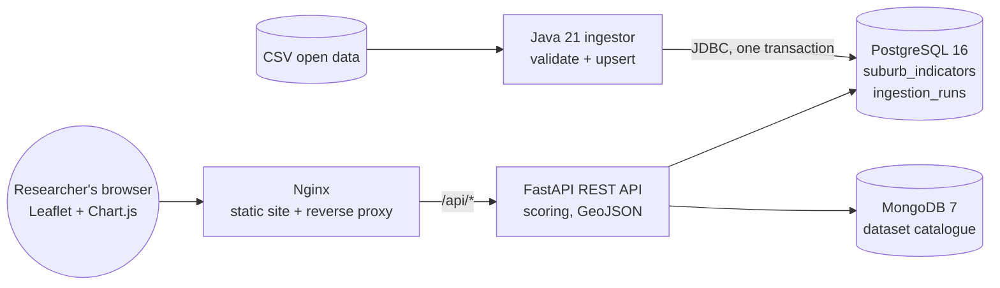

# UrbanPulse: suburb liveability data platform

[](https://github.com/Sri0401/project27/actions/workflows/ci.yml)

UrbanPulse is a small, cloud-ready research data platform. A **Java** job validates suburb indicator data and loads it into **PostgreSQL**. A **Python (FastAPI)** REST API computes a composite liveability score and serves GeoJSON plus an open-dataset catalogue stored in **MongoDB**. A **JavaScript** map dashboard, served by **Nginx**, lets researchers and policymakers explore the results.

Everything is free and open source. It runs with one `docker compose up`, is tested in **GitHub Actions** CI, and deploys to an **Azure** student VM.

> The sample data is illustrative and not official statistics. See [data/README.md](data/README.md) for how to load real open data, for example from AURIN or the ABS.

## Architecture



| Component | Tech | Responsibility |
|---|---|---|
| [ingestor/](ingestor/) | Java 21, Maven, JDBC, JUnit 5 | Parses the CSV by header name and rejects bad rows with line-level errors. Applies the schema, upserts all rows in a single transaction and records an audit row for the run. Aborts if more than 10% of rows are rejected. |
| [api/](api/) | Python 3.11, FastAPI, Pydantic, psycopg 3, PyMongo, pytest | REST endpoints, input validation, liveability scoring, GeoJSON output, an API-key-protected write endpoint and a health check. The repository pattern lets the same code run against Postgres/Mongo or in memory. |
| [web/](web/) | HTML/CSS/JS, Leaflet, Chart.js, Nginx | Map, chart, sortable table and filters. Nginx serves the static files, proxies `/api` and sets security headers (CSP and others). |
| [docker-compose.yml](docker-compose.yml) | Docker Compose | Five services with health checks and start-up ordering. The databases are not exposed to the host. |
| [.github/workflows/](.github/workflows/) | GitHub Actions | Lint, unit tests, Java build, a full-stack Docker smoke test, and SSH deployment to Azure. |
| [deploy/azure/](deploy/azure/) | Azure CLI, cloud-init | One-command provisioning of a B1s Ubuntu VM. |

## How this maps to the role

| Job description | Where it shows up here |
|---|---|
| Design, develop, test and maintain software components | Three components with clear boundaries, 25 automated tests, and linting enforced in CI |
| RESTful services connecting data, analytics and visualisation | FastAPI endpoints feed a Leaflet map and Chart.js. The OpenAPI docs are at `/api/docs` |
| Java, Python, JavaScript | Ingestor, API and frontend respectively |
| Web servers and databases: Nginx, PostgreSQL, MongoDB | Nginx reverse proxy, PostgreSQL for relational indicators, MongoDB for flexible metadata |
| Version control, CI/CD, containerisation | Git workflow ([CONTRIBUTING.md](CONTRIBUTING.md)), PR template, GitHub Actions CI/CD, multi-stage Dockerfiles |
| Cloud-first, scalable deployments | Configured through environment variables (12-factor style), runs on an Azure VM, and can switch to managed Azure databases by changing only the URLs |
| Usable, secure, well-governed systems | Validation at every boundary, parameterised SQL, constant-time API-key check, non-root containers, CSP headers, ingestion audit log, health checks |
| Documentation and support | This README, auto-generated API docs, a data dictionary and a deployment guide |

## Quick start

### Option A: no Docker (API and website, in-memory data)

Needs Python 3.11 or later.

```powershell
cd api
python -m venv .venv
.venv\Scripts\activate              # macOS/Linux: source .venv/bin/activate
pip install -r requirements-dev.txt
$env:DATA_BACKEND="memory"; $env:SERVE_STATIC="true"; $env:API_KEY="dev"
uvicorn app.main:app --reload
```

Open http://localhost:8000 for the dashboard and http://localhost:8000/api/docs for interactive API docs.

### Option B: full stack with Docker (recommended)

Install [Docker Desktop](https://www.docker.com/products/docker-desktop/) (free for personal and education use) or Docker Engine, then run:

```bash
cp .env.example .env        # then edit the passwords
docker compose up -d --build
docker compose logs ingestor   # "Loaded 20 rows from suburbs_sample.csv (0 rejected)"
```

Open http://localhost:8080.

To re-load data after editing the CSV, run `docker compose run --rm ingestor /data/suburbs_sample.csv`.

## API

| Method | Path | Description |
|---|---|---|
| GET | `/api/health` | Checks each data store. Returns 503 if one is down |
| GET | `/api/suburbs` | Filters: `state`, `min_walk_score`, `max_rent`. Also `sort_by`, `order` and `limit` |
| GET | `/api/suburbs/{code}` | One suburb with its score |
| GET | `/api/suburbs/geojson` | GeoJSON FeatureCollection for GIS tools such as QGIS |
| GET | `/api/indicators/summary` | Min, max, mean and median for each indicator |
| GET | `/api/ingestion/latest` | Audit record of the last data load |
| GET | `/api/datasets?tag=` | Open dataset catalogue |
| POST | `/api/datasets` | Register a dataset. Needs the `X-API-Key` header |

```bash
curl "http://localhost:8080/api/suburbs?min_walk_score=85&sort_by=liveability_score&limit=5"
curl -X POST http://localhost:8080/api/datasets -H "X-API-Key: <API_KEY>" -H "Content-Type: application/json" \
  -d '{"slug":"vic-open-space","title":"VIC Open Space","publisher":"DELWP","licence":"CC BY 4.0","url":"https://www.data.vic.gov.au/"}'
```

### Liveability score

Each indicator is min-max normalised across all suburbs. The score is then a weighted sum, scaled to 0 to 100 ([api/app/scoring.py](api/app/scoring.py)):

| Indicator | Weight | Direction |
|---|---|---|
| Walk score | 35% | higher is better |
| Green space % | 25% | higher is better |
| Public transport stops | 25% | higher is better |
| Median weekly rent | 15% | lower is better |

Scores are always relative to the whole dataset, so filtering a list never changes a suburb's score.

## Testing

```bash
cd api && ruff check . && pytest            # 20 tests: scoring, filtering, validation, auth
cd ingestor && mvn verify                   # 5 tests: CSV parsing and validation
```

CI also starts the full Docker stack and runs `curl` checks through Nginx. See [ci.yml](.github/workflows/ci.yml).

## Deploying to Azure

See [deploy/azure/README.md](deploy/azure/README.md). In short, from Azure Cloud Shell run:

```bash
bash deploy/azure/provision.sh https://github.com/Sri0401/project27.git
```

## Project structure

```
api/          FastAPI service (app/, tests/, Dockerfile)
ingestor/     Java ingestion job (Maven project, Dockerfile)
web/          Static frontend + nginx.conf
data/         Sample CSV and data dictionary
deploy/azure/ Provisioning scripts and cloud-init
.github/      CI/CD workflows and PR template
```

## Ideas for extending it

- Add **PostGIS** and real suburb boundary polygons (ABS ASGS), then serve polygons and support spatial queries such as "suburbs within 5 km of a point".
- Let users change the score weights through query parameters.
- Add a Spring Boot version of the ingestor with a REST trigger and a scheduled run.
- Add pagination, rate limiting and OAuth2 (for example, Keycloak) for write endpoints.
- Add Playwright browser tests and Trivy image scanning in CI.
