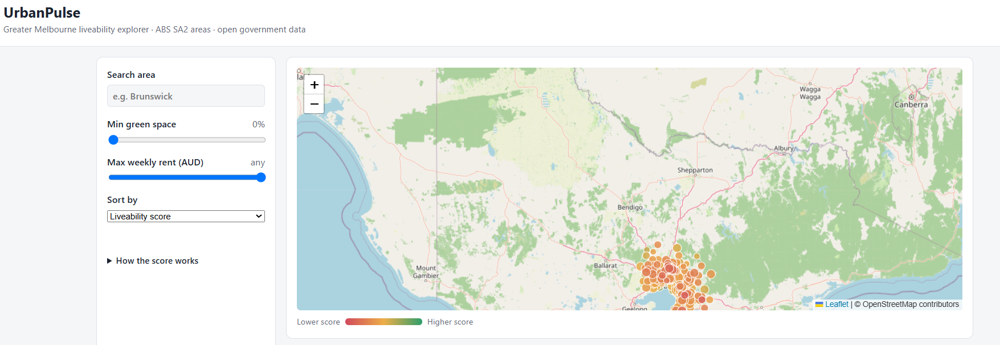
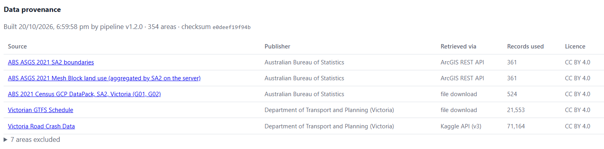
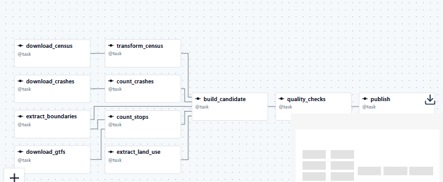
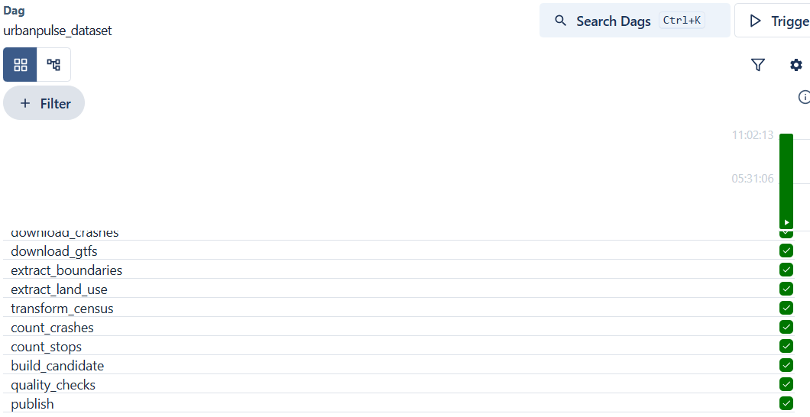
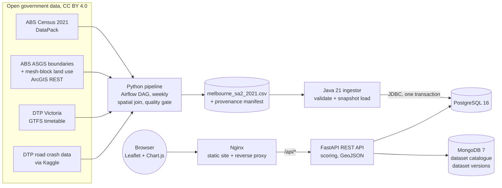

# UrbanPulse: neighbourhood liveability data platform

[](https://github.com/Sri0401/project27/actions/workflows/ci.yml)

**Live demo:** http://4.196.164.233 · **API docs:** http://4.196.164.233/api/docs
(Azure free-tier VM in Australia East, provisioned with Terraform. A small personal demo, so it may occasionally be offline.)

UrbanPulse is a small, cloud-ready research data platform built on **real open government data** for **354 Greater Melbourne neighbourhoods** (ABS SA2 areas).

- A **Python** pipeline, orchestrated by **Apache Airflow**, combines the ABS 2021 Census, ABS boundary and land-use services, the Victorian public transport GTFS feed, and Victorian road crash data from **Kaggle**.
- A **Java** job validates the result and loads it into **PostgreSQL**.
- A **Python (FastAPI)** REST API computes derived indicators and a liveability score, and serves GeoJSON. **MongoDB** holds an open-dataset catalogue and a provenance record of every dataset version.
- A **JavaScript** map dashboard, served by **Nginx**, lets researchers and policymakers explore the results.

Everything is free and open source. It runs with one `docker compose up`, is tested in **GitHub Actions**, and its Azure infrastructure is defined in **Terraform**.

## Screenshots

**Dashboard:** areas coloured by liveability score, with filters, a top-10 chart and a sortable table ([live](http://4.196.164.233))



**Data provenance:** every dataset version records its sources, how each was retrieved, the records used and the licence (stored in MongoDB)



**Airflow:** the weekly pipeline DAG (left) and a successful run with all 11 tasks green (right)

<p>
  
  
</p>

## Architecture



| Component | Tech | Responsibility |
|---|---|---|
| [pipeline/](pipeline/) | Python, Apache Airflow 3, httpx, Shapely, pytest | An **Airflow DAG** of 11 tasks (parallel extracts, retries, a weekly schedule) runs the same stages as the command-line build. A **quality gate** of 8 checks blocks publishing if anything looks wrong. Downloads and caches the sources, and writes a provenance manifest (sources, versions, checksums, parameters, excluded areas) next to the CSV. Gets land use aggregated on the ABS server, counts about 29,000 transport stops per area with a spatial index (STRtree), joins everything on SA2 code, and filters out areas with unreliable data. See [data/README.md](data/README.md). |
| [ingestor/](ingestor/) | Java 21, Maven, JDBC, JUnit 5 | Parses the CSV by header name and rejects bad rows with line-level errors. Applies the schema, replaces the snapshot in a single transaction and records an audit row for the run. Aborts if more than 10% of rows are rejected. |
| [api/](api/) | Python 3.11, FastAPI, Pydantic, psycopg 3, PyMongo, pytest, mongomock | REST endpoints, a provenance store and catalogue statistics in MongoDB (aggregation pipelines, upserts, indexes), input validation, derived indicators, percentile-based scoring, GeoJSON output, an API-key-protected write endpoint and a health check. The repository pattern lets the same code run against Postgres/Mongo or in memory. |
| [web/](web/) | HTML/CSS/JS, Leaflet, Chart.js, Nginx | Map, chart, searchable and sortable table, and filters. Nginx serves the static files, proxies `/api` and sets security headers (CSP and others). |
| [docker-compose.yml](docker-compose.yml) | Docker Compose | Five services with health checks and start-up ordering. The databases are not exposed to the host. |
| [.github/workflows/](.github/workflows/) | GitHub Actions | Lint and tests for every component, Airflow DAG and Terraform validation, a full-stack Docker smoke test, and verification of each production rollout. |
| [deploy/vm/](deploy/vm/) | systemd, bash, GitHub API | **Pull-based continuous deployment**: the VM deploys `main` once CI passes, health-checks and rolls back on failure. SSH stays locked |
| [deploy/terraform/](deploy/terraform/) | Terraform / OpenTofu, azurerm | Infrastructure as Code: network, firewall, VM and budget alert, with validations that keep it inside the Azure free tier. |
| [deploy/azure/](deploy/azure/) | cloud-init, Azure portal | First-boot script that installs Docker and starts the stack, plus a manual portal guide. |

## How this maps to the role

| Job description | Where it shows up here |
|---|---|
| Design, develop, test and maintain software components | Four components with clear boundaries, 72 automated tests, and linting enforced in CI |
| Data pipelines and orchestration | An Apache Airflow DAG with parallel tasks, retries, a schedule and a data-quality gate. See [pipeline/README.md](pipeline/README.md) |
| Integrations and RESTful services connecting data, analytical tools and visualisation | Integrates ABS REST services, the ABS Census, GTFS and the Kaggle API. Exposes a FastAPI REST API that feeds a Leaflet map and Chart.js. OpenAPI docs at `/api/docs` |
| Urban research and policy context | Real neighbourhood indicators (transport access, green space, housing affordability, road safety) at the ABS SA2 geography used in Australian urban research |
| Java, Python, JavaScript | Ingestor, pipeline and API, and frontend |
| Web servers and databases: Nginx, PostgreSQL, MongoDB | Nginx reverse proxy. PostgreSQL for fixed-shape relational indicators. MongoDB for variable-shape documents: the dataset catalogue and versioned provenance records, queried with aggregation pipelines |
| Version control, CI/CD, containerisation | Git workflow ([CONTRIBUTING.md](CONTRIBUTING.md)), PR template, GitHub Actions CI, pull-based continuous deployment with a CI gate and automatic rollback, multi-stage Dockerfiles |
| Infrastructure as Code | Terraform defines all Azure resources, is checked in CI (`fmt`, `validate`), and has guard rails against non-free resources |
| Cloud-first, scalable deployments | Configured through environment variables (12-factor style), runs on an Azure VM, and can switch to managed Azure databases by changing only the URLs |
| Usable, secure, well-governed systems | Data lineage (every dataset version traceable to its source files by checksum), data licences and attribution recorded, documented method and limitations, validation at every boundary, parameterised SQL, constant-time API-key check, non-root containers, CSP headers, ingestion audit log |
| Documentation and support | This README, third-party data notices ([NOTICE.md](NOTICE.md)), auto-generated API docs, a data dictionary with sources and limitations, and deployment guides |

## Quick start

### Option A: no Docker (API and website, in-memory data)

Needs Python 3.11 or later.

```powershell
cd api
python -m venv .venv
.venv\Scripts\activate              # macOS/Linux: source .venv/bin/activate
pip install -r requirements-dev.txt
$env:DATA_BACKEND="memory"; $env:SERVE_STATIC="true"; $env:API_KEY="dev"
uvicorn app.main:app --reload
```

Open http://localhost:8000 for the dashboard and http://localhost:8000/api/docs for interactive API docs.

### Option B: full stack with Docker (recommended)

Install [Docker Desktop](https://www.docker.com/products/docker-desktop/) (free for personal and education use) or Docker Engine, then run:

```bash
cp .env.example .env        # then edit the passwords
docker compose up -d --build
docker compose logs ingestor   # "Loaded 354 rows from melbourne_sa2_2021.csv (0 rejected)"
```

Open http://localhost:8080.

### Rebuilding the dataset

The processed CSV is committed, so you don't need to run the pipeline to use the app. To rebuild it from the sources (about 330 MB of downloads the first time, then cached; no Kaggle account needed):

```bash
cd pipeline && pip install -r requirements.txt && python build_dataset.py   # or run the Airflow DAG, see pipeline/README.md
docker compose run --rm ingestor /data/melbourne_sa2_2021.csv   # reload into PostgreSQL
```

## API

| Method | Path | Description |
|---|---|---|
| GET | `/api/health` | Checks each data store. Returns 503 if one is down |
| GET | `/api/about` | Data sources, licence links and the required attribution |
| GET | `/api/suburbs` | Filters: `q` (name), `state`, `min_green_space`, `max_rent`. Also `sort_by`, `order` and `limit` |
| GET | `/api/suburbs/{code}` | One area by ABS SA2 code, with derived indicators and score |
| GET | `/api/suburbs/geojson` | GeoJSON FeatureCollection for GIS tools such as QGIS |
| GET | `/api/indicators/summary` | Min, max, mean and median for each indicator |
| GET | `/api/ingestion/latest` | Audit record of the last data load |
| GET | `/api/datasets?tag=` | Open dataset catalogue |
| GET | `/api/datasets/tags` | Number of datasets per tag (MongoDB aggregation pipeline) |
| GET | `/api/provenance` | How the current dataset was built: sources, versions, checksums, parameters, excluded areas |
| GET | `/api/provenance/history` | Summary of every recorded dataset version |
| POST | `/api/datasets` | Register a dataset. Needs the `X-API-Key` header |

```bash
curl "http://localhost:8080/api/suburbs?min_green_space=20&sort_by=liveability_score&limit=5"
curl "http://localhost:8080/api/suburbs/206071142"      # Fitzroy
curl -X POST http://localhost:8080/api/datasets -H "X-API-Key: <API_KEY>" -H "Content-Type: application/json" \
  -d '{"slug":"vic-open-space","title":"VIC Open Space","publisher":"DEECA","licence":"CC BY 4.0","url":"https://www.data.vic.gov.au/"}'
```

### Why MongoDB as well as PostgreSQL?

The two databases hold different kinds of data:

- **PostgreSQL** holds the indicators: one fixed-shape row per area, with constraints and types. They're joined, filtered and sorted, and reloaded as one transactional snapshot.
- **MongoDB** holds **documents whose shape varies**:
  - **`datasets`**: catalogue entries. Each publisher describes its data differently. A unique index on `slug` and a multikey index on `tags` support lookups. `/api/datasets/tags` counts tags with an aggregation pipeline (`$unwind`, `$group`, `$sort`, `$project`).
  - **`dataset_versions`**: one provenance document per dataset build, taken from the pipeline's manifest. Each one nests a different set of sources (some have a version, some a checksum, some neither) and a variable list of excluded areas. On start-up the API **upserts** the document keyed on the CSV's SHA-256, so it's stored exactly once even with several API replicas. `/api/provenance/history` summarises versions with an aggregation pipeline that counts excluded areas inside the database.

The MongoDB code is unit-tested against **mongomock**, an in-memory MongoDB. CI also runs it against a real MongoDB 7 container, including a restart that checks the upsert really is idempotent.

### Liveability score

The score is computed in [api/app/scoring.py](api/app/scoring.py). Each area is ranked against all others on four indicators. The percentile ranks (0 to 1) are then combined with these weights and scaled to 0 to 100:

| Indicator | Weight | Direction |
|---|---|---|
| Public transport stops per km² | 30% | higher is better |
| Green space (% of land that is parkland) | 25% | higher is better |
| Rent as a % of household income | 30% | lower is better |
| Injury road crashes per 1,000 residents per year (2019 to 2023) | 15% | lower is better |

Percentile ranks are used instead of min-max scaling because real data has outliers: the CBD's stop density would otherwise squash every other area towards zero. Scores are relative to the whole dataset, so filtering a list never changes an area's score. This is a demonstration index, not an official measure.

## Testing

```bash
cd api && ruff check . && pytest            # 38 tests: scoring, filtering, validation, auth, attribution, MongoDB repositories, provenance, data contracts
cd pipeline && ruff check . && pytest       # 25 tests: parsing, spatial counting, joins, quality checks, stages, manifest
# + 4 Airflow DAG tests (structure, schedule, dependencies, retries), run in WSL/Linux and in CI
cd ingestor && mvn verify                   # 5 tests: CSV parsing and validation
```

CI also validates the Terraform, starts the full Docker stack, loads the real dataset and runs `curl` checks through Nginx. See [ci.yml](.github/workflows/ci.yml).

## Deploying to Azure

The stack runs on one Azure for Students free-tier VM (`Standard_B2ats_v2` or `Standard_B1s`, with a 64 GiB P6 disk). A cloud-init script installs Docker and starts everything on first boot. After that, the VM **deploys every green commit on `main` by itself** ([deploy/vm/](deploy/vm/README.md)).

```powershell
cd deploy/terraform
copy terraform.tfvars.example terraform.tfvars   # fill in subscription, your IP, email
terraform init
terraform plan -out tfplan
terraform apply tfplan
```

See [deploy/terraform/README.md](deploy/terraform/README.md) for setup, and [deploy/azure/README.md](deploy/azure/README.md) for the cost rules and a manual portal route.

## Project structure

```
pipeline/         Data pipeline: stages, quality checks, Airflow DAG (dags/) and WSL setup (airflow-setup/)
data/             Processed dataset, provenance manifest and data dictionary
ingestor/         Java ingestion job (Maven project, Dockerfile)
api/              FastAPI service (app/, tests/, Dockerfile)
web/              Static frontend + nginx.conf
deploy/terraform/ Infrastructure as Code for Azure
deploy/azure/     cloud-init and manual portal guide
.github/          CI workflows and PR template
```

## Licence

The **code** is released under the [MIT License](LICENSE). The **data** in `data/` is derived from third-party open data and keeps its own licence (CC BY 4.0). See the attribution below and [NOTICE.md](NOTICE.md).

## Data attribution

Based on ABS data: Australian Bureau of Statistics, 2021 Census of Population and Housing, General Community Profile DataPack (Release 2, files dated 16 January 2023), SA2, Victoria; and Australian Statistical Geography Standard (ASGS) Edition 3, July 2021 - June 2026; both accessed 20 October 2026 (https://www.abs.gov.au). ABS data used with permission from the Australian Bureau of Statistics. Also based on Department of Transport and Planning (Victoria) data: GTFS Schedule, accessed 20 October 2026; and [Victoria Road Crash Data](https://discover.data.vic.gov.au/dataset/victoria-road-crash-data), accessed 12 October 2026, serialised and versioned by National Digital at [publicdata.au](https://publicdata.au/d/vic-road-crashes/v/2026-10-12/), which added ABS area codes to each crash, and obtained via the Kaggle dataset [nationaldigitalau/vic-road-crashes](https://www.kaggle.com/datasets/nationaldigitalau/vic-road-crashes). All licensed under CC BY 4.0 (https://creativecommons.org/licenses/by/4.0/). Changes were made: data joined, aggregated to SA2 and filtered. Derived indicators and the liveability score are UrbanPulse calculations, not ABS or DTP statistics. Not endorsed by the ABS or DTP. Map tiles © OpenStreetMap contributors (ODbL). Full notices: [NOTICE.md](NOTICE.md).

## Ideas for extending it

- Add **PostGIS** and serve the SA2 boundary polygons for a choropleth map, plus spatial queries such as "areas within 5 km of a point".
- Let users change the score weights through query parameters.
- Weight stops by service frequency from GTFS `stop_times`, not just stop count.
- Add a Spring Boot version of the ingestor with a REST trigger and a scheduled run.
- Add Playwright browser tests and Trivy image scanning in CI.
