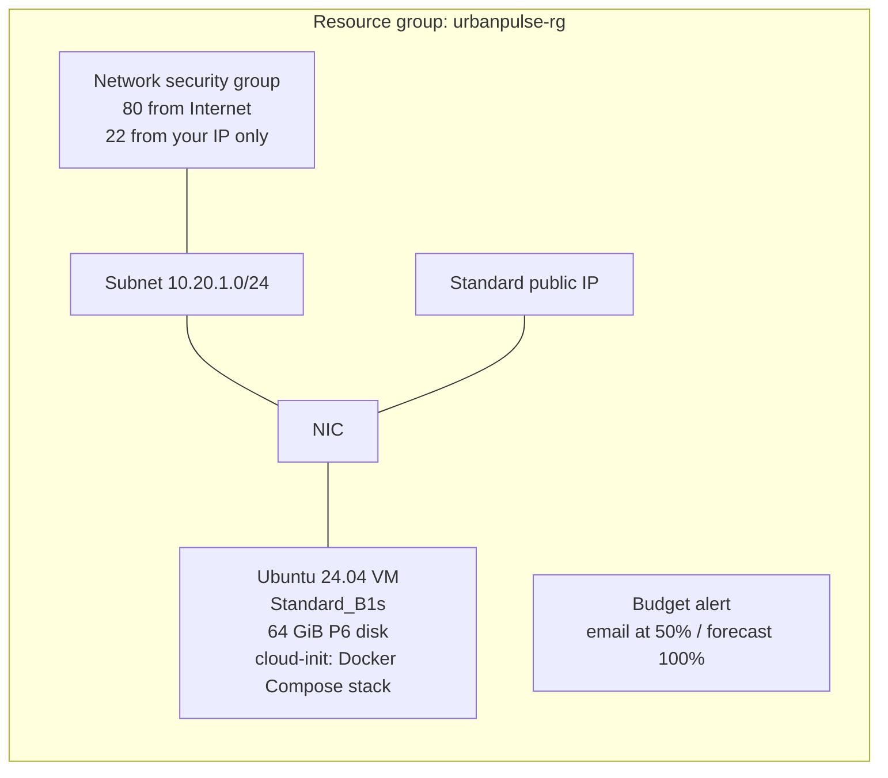

# Infrastructure as Code: Azure with Terraform

This folder defines the whole Azure deployment as code: network, firewall, public IP, VM and a budget alert. One `terraform apply` creates it, and one `terraform destroy` removes all of it.



## Free-tier guard rails

The config refuses to create anything outside the Azure for Students free allowance:

| Rule | How it's enforced |
|---|---|
| VM must be a free size | `vm_size` validation allows only `Standard_B1s` or `Standard_B2ats_v2` |
| Disk must be a free P6 | `os_disk_size_gb` validation requires exactly 64 GiB Premium SSD |
| No paid extras | Boot diagnostics, backup, monitoring and Defender are not defined |
| Early warning | Optional budget sends email at 50% of US$5, and when the forecast reaches 100% |
| Easy clean-up | `terraform destroy` removes everything, so nothing is left running |

The **Standard public IP** is the only cost, about US$3–4 a month from student credit. Azure doesn't include public IPs in the free allowance, and the VM needs one.

## One-time setup (Windows)

```powershell
winget install Hashicorp.Terraform      # or the open-source fork: winget install OpenTofu.Tofu
winget install Microsoft.AzureCLI
# Close and reopen the terminal so both commands are on PATH.

az login                                 # opens the browser; pick your Azure for Students account
az account show --query "{name:name, id:id}" -o table

ssh-keygen -t ed25519 -f $HOME\.ssh\urbanpulse_ed25519 -N '""'   # key used to log in to the VM
```

## Deploy

Push your latest code first, because the VM clones the repo on first boot.

```powershell
cd deploy\terraform
Copy-Item terraform.tfvars.example terraform.tfvars
notepad terraform.tfvars        # subscription_id, ssh_allowed_cidr (your IP + /32), budget_email
(Invoke-RestMethod https://api.ipify.org) + "/32"    # prints your IP in the right format

terraform init
terraform plan -out tfplan       # read this: 8-9 resources, Standard_B1s, disk_size_gb = 64
terraform apply tfplan
```

The outputs print the website URL and an SSH command. Docker builds take about 10 minutes on a B1s. To watch progress:

```powershell
terraform output -raw check_progress_command | Invoke-Expression
```

To get the generated API key, run `ssh ... "grep API_KEY ~/urbanpulse/.env"`, using the SSH command from the outputs.

## Day-2 operations

| Task | Command |
|---|---|
| Your home IP changed | Edit `ssh_allowed_cidr`, then `terraform apply`. Only the firewall rule changes |
| See what is deployed | `terraform state list` / `terraform show` |
| Detect manual changes (drift) | `terraform plan` (should say *No changes*) |
| Update the app | Automatic: merge to `main`, and the VM deploys it after CI passes (see [../vm/README.md](../vm/README.md)) |
| Remove everything | `terraform destroy` |

## Troubleshooting

| Error | Fix |
|---|---|
| `SkuNotAvailable ... Capacity Restrictions: Standard_B1s` | Azure has no B1s capacity in that region right now. Switch to the other free size by adding `vm_size = "Standard_B2ats_v2"` to `terraform.tfvars`, then `terraform plan -out tfplan` and `terraform apply tfplan`. Only the VM is created; the network resources already made are kept. This happened in `australiaeast` on 2026-10-23. |
| `RequestDisallowedByPolicy` | Azure for Students limits which regions you can use. List them with `az policy assignment list --query "[].parameters.listOfAllowedLocations.value" -o json` and set `location` to one of them. |
| `az login` says "You don't have access to this" | Your university may block some sign-in methods (for example, device code). Run `az config set core.enable_broker_on_windows=false`, then `az login`, to sign in through a normal browser tab. |
| SSH times out | Your IP has changed. Update `ssh_allowed_cidr` and apply again. |

## Notes

- **State**: `terraform.tfstate` stays on your machine and is ignored by git. It describes your infrastructure, so don't share it. Teams normally keep state in a remote backend such as Azure Storage with locking. That's left out here because it would use credit.
- **cloud-init** is shared with the portal route ([../azure/cloud-init.yaml](../azure/cloud-init.yaml)). It only runs on first boot, so Terraform ignores later edits to it. To rebuild with a changed file, run `terraform apply -replace=azurerm_linux_virtual_machine.main`.
- **Deployments**: the VM pulls releases itself (pull-based continuous deployment), so SSH can stay locked to your IP. The *Deploy to Azure VM* workflow verifies each rollout. See [../vm/README.md](../vm/README.md).
- **CI** runs `terraform fmt -check` and `terraform validate` on every push.
