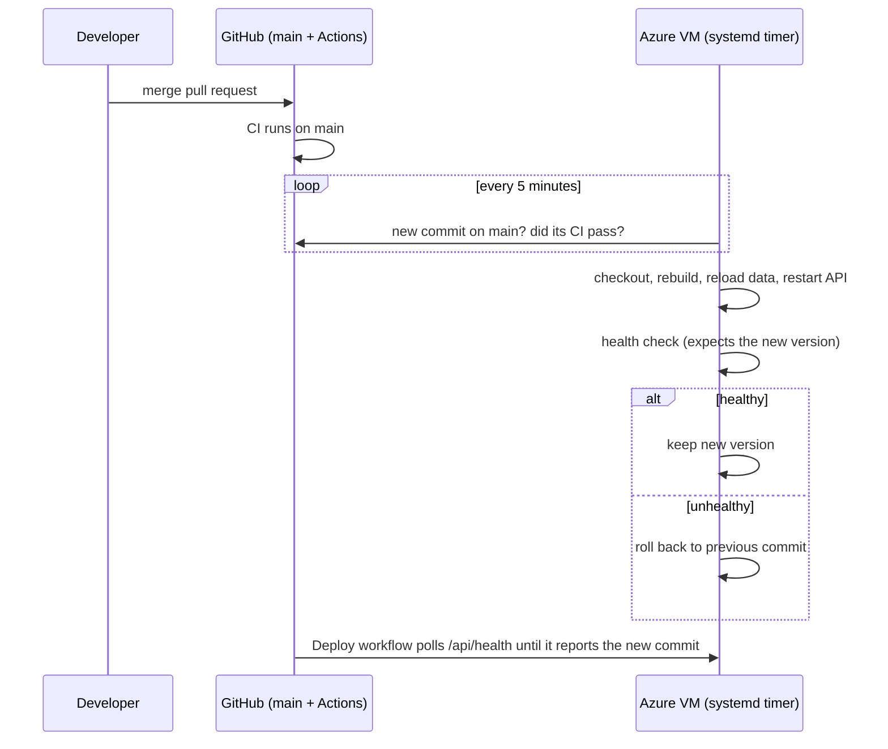

# Continuous deployment to the VM (pull-based)

The VM **deploys itself**. GitHub never connects to it, so SSH can stay locked to the owner's IP address.



| File | Purpose |
|---|---|
| [deploy.sh](deploy.sh) | Checks `main`, deploys only commits whose **CI passed**, health-checks the result and **rolls back** on failure |
| [urbanpulse-deploy.service](urbanpulse-deploy.service) | systemd unit that runs `deploy.sh` once |
| [urbanpulse-deploy.timer](urbanpulse-deploy.timer) | Runs the service every 5 minutes, and 2 minutes after boot |
| [install.sh](install.sh) | Installs `jq` and the unit files, then starts the timer |

New VMs get this automatically from [cloud-init](../azure/cloud-init.yaml). On a VM created before it existed, install it once:

```bash
ssh -i ~/.ssh/urbanpulse_ed25519 azureuser@<vm-ip> \
  "cd ~/urbanpulse && git pull && sudo bash deploy/vm/install.sh"
```

## How a release flows

1. Merge a pull request into `main`. CI runs on the merge commit.
2. Within 5 minutes of CI passing, the VM deploys the commit and sets `APP_VERSION` to its short hash.
3. [`.github/workflows/deploy.yml`](../../.github/workflows/deploy.yml) waits until `/api/health` reports that version, then smoke-tests the live site. A green run means the release is live. The run is recorded as a GitHub **production** deployment.

## Design choices

- **Pull, not push:** GitHub's runners connect from thousands of changing addresses. Pushing over SSH would mean opening port 22 to the whole internet. With pulling, the VM only makes outbound HTTPS requests.
- **CI gate:** the VM asks the public GitHub API whether the `CI` workflow succeeded for the exact commit. A failing or still-running build is never deployed.
- **Safe self-update:** `deploy.sh` runs everything inside `main()`, because `git checkout` replaces the script while it runs.
- **Rollback:** if the new version isn't healthy within 5 minutes, the previous commit is checked out and rebuilt.

## Operating it

```bash
journalctl -u urbanpulse-deploy -n 50        # recent deployments and their outcome
systemctl list-timers urbanpulse-deploy.timer  # when the next check runs
sudo systemctl start urbanpulse-deploy        # check for a release right now
curl -s localhost/api/health                  # shows the deployed version
```
