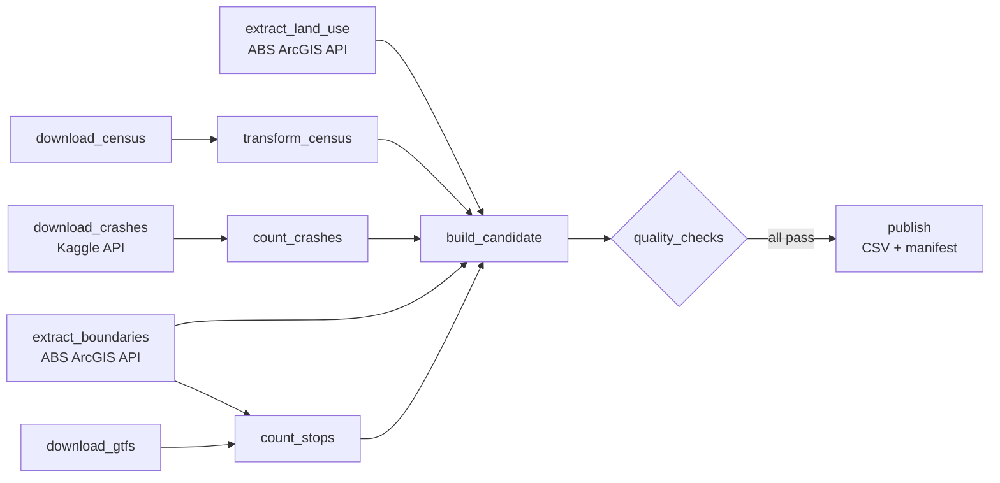

# Data pipeline

Builds [`data/melbourne_sa2_2021.csv`](../data/melbourne_sa2_2021.csv) and its provenance manifest from five open-data sources. The dataset is described in [data/README.md](../data/README.md).

The pipeline is split into **stages** ([stages.py](stages.py)). Each stage reads its inputs from, and writes its output to, a work directory, so the same code can run in two ways:

| How | Command | When to use it |
|---|---|---|
| **Command line** | `python build_dataset.py` | Quick local rebuild; runs every stage in order |
| **Apache Airflow** | DAG [`urbanpulse_dataset`](dags/urbanpulse_dataset.py) | Scheduled weekly runs, parallel tasks, retries, monitoring in the Airflow UI |

## The DAG



- **Parallel extract:** the five downloads and API calls don't depend on each other, so Airflow runs them at the same time.
- **Retries:** every task retries twice, with growing waits, because government APIs and large downloads occasionally fail. The quality gate has no retries, because a failed check means a data problem that retrying won't fix.
- **Quality gate:** [quality.py](quality.py) runs 8 checks before anything is published. They cover schema, blank values, unique codes, points inside Victoria, value ranges, enough areas published, and whether the stop and crash joins actually matched. If any check fails, the run stops and **the previous dataset stays in place**. `publish` also refuses to run unless the current candidate has passed.
- **Schedule:** weekly (`@weekly`), with `catchup=False`, and only one run at a time, because runs share a work directory.
- **Cached downloads:** a weekly run only downloads again when asked to. Trigger the DAG with the `refresh` parameter set to `true` to fetch fresh source files.

## Running Airflow locally

Airflow runs on Linux, so on Windows use **WSL** (Ubuntu). No admin rights or Docker are needed.

```bash
# One-time setup: installs uv, Python 3.12 and Airflow 3.3.2 (pinned with Airflow's constraints file)
bash pipeline/airflow-setup/setup_wsl.sh

# In each new shell
source pipeline/airflow-setup/env.sh

# Run the whole DAG once, without the scheduler (good for testing)
airflow db migrate
airflow dags test urbanpulse_dataset

# Or start the full Airflow (scheduler + web UI) at http://localhost:8080
airflow standalone      # prints the admin password on first start
```

In the UI, open **urbanpulse_dataset**, switch it on, and press **Trigger**. The *Graph* view shows each task's status, and each task's *Logs* show what it did, for example "All 8 quality checks passed".

`env.sh` sets where data goes: `URBANPULSE_CACHE_DIR` (downloads), `URBANPULSE_WORK_DIR` (intermediate files) and `URBANPULSE_OUTPUT` (the published CSV). Override them to run without touching the committed dataset, for example `URBANPULSE_OUTPUT=/tmp/out.csv airflow dags test urbanpulse_dataset`.

## Tests

```bash
pytest -q                  # 25 tests: parsing, spatial counting, joins, quality checks, stages, manifest
pytest -q tests/test_dag.py   # 4 DAG tests; need Airflow installed, so they are skipped on Windows
```

CI runs the pipeline tests on every pull request, plus a separate job that installs Airflow and checks that the DAG loads, its schedule, every task dependency and its retry policy. None of the tests call the live government APIs.

The DAG was run end to end with `airflow dags test` (Airflow 3.3.2, Python 3.12, WSL Ubuntu). All 11 tasks succeeded, and the output CSV was byte-identical to the command-line build (SHA-256 `e0deef19…`).
